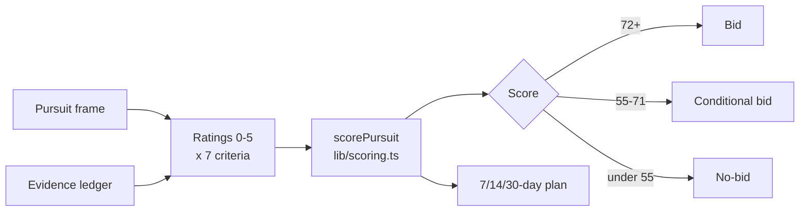

# CaptureCoach

A bid/no-bid decision room for small government-contracting teams: frame one pursuit, log the evidence, score seven qualification factors and leave with a Bid, Conditional bid or No-bid call plus a dated action plan.

**Live:** [capturecoach.vercel.app](https://capturecoach.vercel.app)

## Why

Small GovCon teams often commit weeks of proposal effort before anyone has challenged whether the pursuit is winnable. CaptureCoach forces that conversation early. The score is deterministic and every weight is visible, so the recommendation can be argued with rather than taken on faith.

## Features

- **Pursuit frame**: mission, buyer, timing, value and what the team already knows, without uploading files.
- **Seven weighted criteria** rated 0–5: strategic fit (18), customer need (18), customer access (14), solution advantage (18), competitive position (12), economics (10), delivery confidence (10).
- **Transparent recommendation**: 72+ is **Bid**, 55–71 **Conditional bid**, below 55 **No-bid**, plus an evidence-confidence score showing how much weight rests on strong ratings.
- **Evidence ledger** with text-only evidence entries (file uploads are disabled on purpose).
- **7/14/30-day action plan** tabs: price the pursuit, run a second gate, then commit or exit.
- **Content provenance register** and a **production release gate** that spell out the licensing and security work needed before real customer data.
- One-click "clear this demo from this device".
- Landing page with a $750 decision-clinic offer through a Stripe Payment Link, plus privacy and terms pages.

## How it works



Everything runs in the browser. State is saved to `localStorage` under `capturecoach-demo-v1`; there is no backend, authentication, AI provider or database. The scoring logic is a pure function in `lib/scoring.ts` with unit tests next to it.

## Tech stack

Next.js 16 (App Router), React 19, TypeScript, plain CSS, Node's test runner with `--experimental-strip-types`.

## Getting started

```bash
npm install
cp .env.example .env.local   # optional
npm run dev                  # http://localhost:3000
```

| Variable | Purpose |
| --- | --- |
| `NEXT_PUBLIC_STRIPE_CLINIC_LINK` | Stripe Payment Link for the $750 decision clinic. Empty shows a placeholder link. |
| `NEXT_PUBLIC_BUSINESS_EMAIL` | Planned monitored inbox for the expert-partner inquiry button. |

Checks:

```bash
npm test
npm run typecheck
npm run build
```

## Project structure

```
app/
  page.tsx                 landing page, guardrails, clinic offer
  room/decision-room.tsx   the interactive decision room (client component)
  privacy/, terms/         legal pages
  robots.ts, sitemap.ts    metadata routes
lib/
  scoring.ts               criteria, weights, scorePursuit()
  scoring.test.ts          scoring unit tests
```

## Status

Live at [capturecoach.vercel.app](https://capturecoach.vercel.app) as a demo with one fictional pursuit. All guidance and sample material is original. It is a decision aid, not legal, procurement or award advice. Before real customer use it needs authentication, tenant isolation, encrypted persistence, audit logs and a data-classification review; never enter CUI, classified or export-controlled information.

Built by [Ian Royes](https://github.com/ianroyes-sys) / Royz Media Group LLC.
